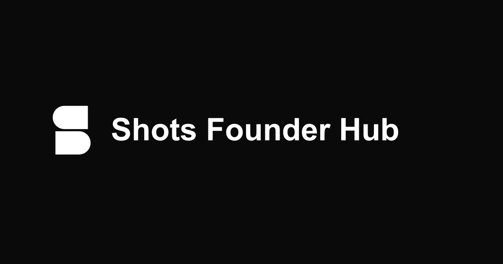

Shots Founder Hub is a fork of [Anarlog](https://github.com/fastrepl/anarlog). Upstream copyright, license notices, and contributor credits are preserved.

<div align="center">


<h1>Shots Founder Hub</h1>

<p>
    <b>Build your personal brand from the work you already do.</b>
    <br />
    Speak an idea. Find a takeaway. Create and schedule with Shots.
  </p>

<p>
    <a href="#get-started">Get started</a>
    &nbsp;•&nbsp;
    <a href="docs/">Documentation</a>
    &nbsp;•&nbsp;
    <a href="#contributing">Contributing</a>
    &nbsp;•&nbsp;
    <a href="LICENSE">License</a>
    &nbsp;•&nbsp;
    <a href="mailto:team@playbookmedia.io">Contact Playbook</a>
  </p>



</div>

<br />

Shots Founder Hub is developed by Playbook Media Interactive LLC to help founders create content and visuals with Shots. Speak an idea or extract takeaways from meeting notes and transcripts, add your point of view, then review and schedule your content.

The desktop capture foundation stores its core record locally in SQLite and supports notes, audio, transcripts, summaries, and exports. Connected features have separate processing requirements and depend on the services you configure.

## Why Shots Founder Hub

- **No bot joins your call.** Shots Founder Hub captures audio directly on your device. Nothing appears in the participant list, and nothing records from inside the meeting.
- **Local when you choose it.** On supported Macs, available built-in transcription models run on-device. Local Intelligence providers keep summaries and chat on your computer too.
- **Your data, in a format you can read.** Sessions, notes, and transcripts live in local SQLite. Recordings and attachments are plain local files. Export Markdown whenever it fits your workflow.
- **Bring your own AI.** Use a supported hosted provider, your own API key, or an OpenAI-compatible local server such as Ollama, LM Studio, or Unsloth.
- **Readable source, MIT.** The community application is MIT-licensed. Fork it, audit it, sell it, or build it yourself.
- **Explicit cloud choices.** The core local record can be used without cloud services. Hosted AI, encrypted CloudSync, and sharing require their configured services.
- **Separate component licenses.** Enterprise components remain source-visible under their existing commercial license; the fork does not change those terms.

## What runs where

| Part of the workflow         | Where it happens                                                  |
| ---------------------------- | ----------------------------------------------------------------- |
| Audio capture and recording  | Your device                                                       |
| Transcription                | Your device with an on-device model, or the provider you select   |
| Notes and transcript storage | Local SQLite plus local files                                     |
| AI summaries and chat        | Your choice: local model, your own API key, or optional hosted AI |
| Sync and sharing             | Off by default, opt-in encrypted CloudSync                        |

## How AI works

Shots Founder Hub keeps audio transcription separate from the language model used for summaries and chat. You can change either one without changing the other.

| Stage                                       | App setting       | Hosted path (when configured) | Local or bring your own                                                                   |
| ------------------------------------------- | ----------------- | -------------------------------------------------------------------------------------------------------------------------------------------------------- | ----------------------------------------------------------------------------------------- |
| Audio → transcript                          | **Transcription** | The hosted transcription provider and supported fallback routes configured for the request. | Soniqo or Apple Speech when available, or your selected transcription provider and model  |
| Transcript + memo → summary, title, or chat | **Intelligence**  | The hosted model configured for summaries or chat. Repository support does not establish the active production provider or model.                                           | Your selected API, subscription, OpenAI-compatible server, or eligible Apple Intelligence |

The active provider and model are always visible under **Settings → Transcription** and **Settings → Intelligence**. Read [Models and providers](https://docs.anarlog.so/models-and-providers) for the current routes, local model list, and privacy boundaries.

## Get started

1. Build this fork from source using the instructions below. Existing [upstream downloads](https://anarlog.so/download) are Anarlog release artifacts; this change does not publish fork-branded binaries.
2. Open it and join a meeting. Shots Founder Hub records on your device and transcribes with the model you selected.
3. Generate a note, edit it like a document, and export Markdown when you need it.
4. Optional: connect an LLM provider or a local model in settings for summaries and chat.

Product docs live at [docs.anarlog.so](https://docs.anarlog.so). To build the desktop app or website from source, follow [Local development](#local-development).

## Repository map

| Path               | What lives there                                                                           |
| ------------------ | ------------------------------------------------------------------------------------------ |
| `apps/desktop`     | Tauri v2 desktop app: React and TypeScript UI, Rust backend                                |
| `apps/web`         | anarlog.so website, account portal, and shared-note pages; not the desktop notepad         |
| `apps/api`         | Optional hosted services for AI, sync, sharing, and integrations                           |
| `apps/cli`         | Local CLI and MCP server                                                                   |
| `apps/mobile`      | iOS and Android client, available as a beta through TestFlight and Google Play             |
| `apps/stripe`      | Billing integration                                                                        |
| `apps/watch/apple` | watchOS companion source built with the mobile app                                         |
| `plugins/*`        | Tauri capabilities such as local STT, database access, calendar, export, and notifications |
| `crates/*`         | Rust libraries for audio capture, transcription, diarization, storage, and services        |
| `packages/*`       | Shared TypeScript packages for the editor, database, UI, and plugin SDK                    |
| `supabase/`        | Hosted authentication, sharing, sync, billing, and Cloud API data                          |
| `skills/anarlog`   | Published agent skill for the CLI and MCP server                                           |
| `enterprise/`      | Source-visible enterprise components, commercially licensed                                |

## Local development

The local-first desktop app and website start without secrets. Hosted AI, CloudSync, authentication, billing, and connected integrations need their optional local services and configuration.

You need Node.js 22 or later, pnpm 11.1.1, Rust 1.94.0, [process-compose](https://f1bonacc1.github.io/process-compose/installation/) 1.122.0 or later (`brew install process-compose` on macOS), and the [Tauri v2 system dependencies](https://v2.tauri.app/start/prerequisites/). Apple Silicon Macs also need Xcode with its Metal Toolchain component to compile the MLX shader library (Xcode 26 and later: `DEVELOPER_DIR=/Applications/Xcode.app/Contents/Developer xcodebuild -downloadComponent MetalToolchain`); the Command Line Tools alone are not enough. On Debian or Ubuntu, the repository can install the required toolchains and system packages:

```bash
bash scripts/setup-linux.sh
```

Install the workspace and start the app you want to work on:

```bash
pnpm install --frozen-lockfile
pnpm dev:desktop
# or
pnpm dev:web
```

Process Compose builds shared UI first, manages the app processes, and saves logs under `.process-compose/`. Use `pnpm dev` for the combined desktop, web, API, and local Supabase stack after configuring the optional backend.

Read [CONTRIBUTING.md](CONTRIBUTING.md) for backend setup, process controls, validation commands, code ownership, and the contribution workflow. Ask [DeepWiki](https://deepwiki.com/fastrepl/anarlog) for a code-indexed explanation of a subsystem.

## Upstream history and attribution

Shots Founder Hub is a separate fork of **Anarlog** developed by **Playbook Media Interactive LLC**. Anarlog's upstream project previously used the **Hyprnote** and **Char** names. The upstream team also maintains a separate productivity product at [char.com](https://char.com).

That history, upstream customers, contributors, and release notes are not claims about Playbook's company history or customer base. Required copyright, contributor attribution, and component license notices are preserved.

## Contributing

Issues, pull requests, bug reports, and docs fixes are all welcome.

- Read [CONTRIBUTING.md](CONTRIBUTING.md) before opening a pull request.
- Contact [team@playbookmedia.io](mailto:team@playbookmedia.io) with project questions.

Contributions outside `enterprise/` are distributed under the MIT license.

## License

- Community application: [MIT](LICENSE)
- Enterprise components: [commercial](LICENSE.enterprise)
- Full boundary: [LICENSING.md](LICENSING.md)

Maintained by [fastrepl](https://github.com/fastrepl).

## Contributors

<a href="https://github.com/fastrepl/anarlog/graphs/contributors">
  
</a>
