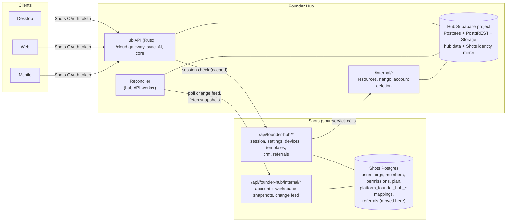
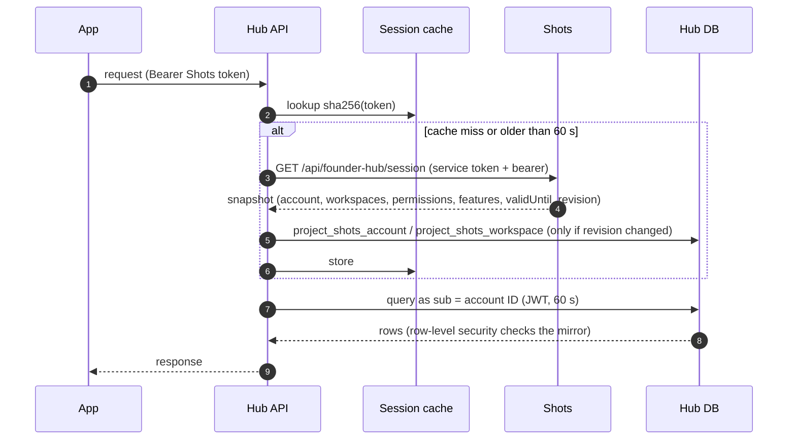
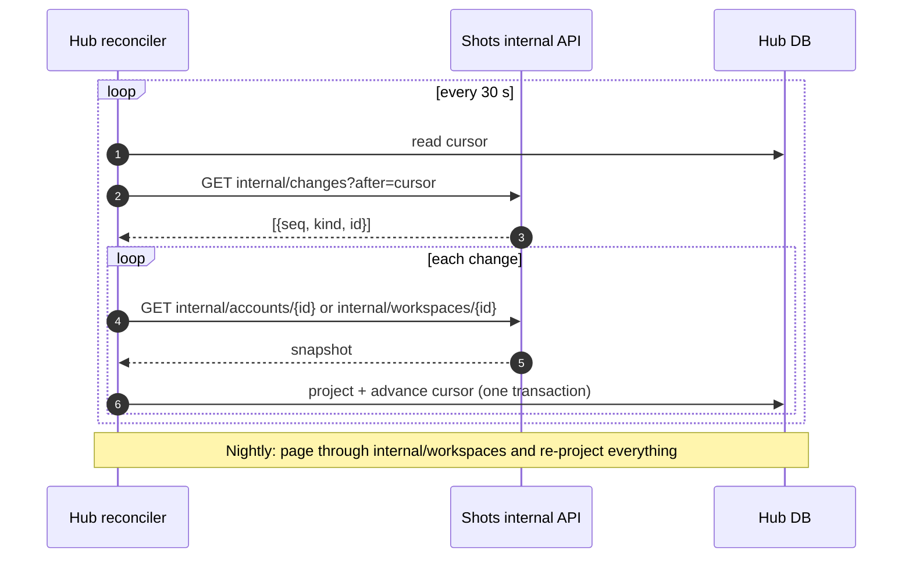
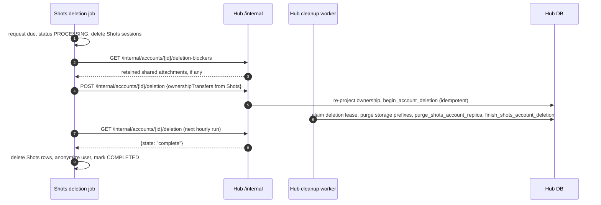

# Founder Hub on its own database

**Status:** proposed.

## Decisions

- The Founder Hub moves to its own database. It no longer lives inside the Shots Postgres.
- Shots stays the only identity store: accounts, workspaces, members, roles, permissions, plan, billing, settings, CRM and referrals.
- The hub mirrors the Shots identity it needs and reconciles it through the Shots API.
- The hub database is a Supabase project.
  - Run it locally with the Supabase CLI for several weeks before provisioning anything.
  - Then soak it in a free staging project, then provision production.
- Files stay on Supabase Storage at first. Moving to Cloudflare R2 is an optional later phase (phase 9).
- The Rust API keeps using Supabase's REST layer at first. Querying Postgres directly with `sqlx` is an optional later phase (phase 10). The workspace already uses `sqlx`.
- There are no users yet, so there is no data to migrate.

## Goals

1. **Separation.** The hub's schema, roles and data live only in the hub database. Shots code never reads or writes hub tables, and hub SQL never references Shots objects.
2. **Shots is authoritative.** Every hub permission decision uses mirrored Shots state, and that state converges after a change in Shots:
   - within seconds when a user makes a request;
   - within about a minute through the change feed;
   - within a day for time-based expiry, through the nightly full refresh.
3. **Proven before provisioning.** One command brings up both stacks locally, and a CI job proves the acceptance list (section 9) on every PR in either repository.

## Out of scope

- Porting hub features into Shots, or rewriting the Rust API.
- The `enterprise/` directory. It is under Anarlog's commercial license and stays off.
- The desktop updater signing key and release publishing. They are tracked separately.

---

## 1. How it works today (verified)

### 1.1 Where the hub's data lives

The paired setup runs entirely on Shots infrastructure (`scripts/local-dev.mjs`):

- **One Postgres, the Shots database.** It holds Shots tables plus the hub schemas `founder_hub`, `founder_hub_private`, `founder_hub_identity` and `founder_hub_billing`, and a `storage` schema.
- **Shots creates the hub schema.** `platform-migrate --founder-hub bootstrap|apply` installs it from `server/founderhubmigrations/sql` in the Shots repo, with a checksum ledger in `founder_hub_private.schema_migrations`.
- **Those files are generated from this repo.** `dev/import-founder-hub-schema.py` copies `supabase/migrations` from here into Shots, renaming schemas (`public`→`founder_hub`, `auth`→`founder_hub_identity` and so on) and roles (`anon`→`shots_hub_anon` and so on).
- **The data engines** are PostgREST v16.5 and `supabase/storage-api` v1.48.27, fronted by Shots' Go `founder-hub-storage` proxy. The hub API's `SUPABASE_URL` points at that proxy.
- **The access keys are minted locally.** The "anon" and "service role" keys are JWTs signed with `SUPABASE_JWT_SECRET`, with roles `shots_hub_anon` and `shots_hub_service_role`.

### 1.2 Where the schema has drifted

- Shots has six hub migrations that this repo doesn't have:
  - `20261110010000_runtime_schema_access`
  - `20261110012000_shots_account_cleanup`
  - `20261110013000_shots_deleting_roster`
  - `20261110014000_owner_scoped_nango_connection_write`
  - `20261110014001_restrict_nango_connection_mutations`
  - `20261110150000_referrals_use_shots_workspace_billing`
- Hub Rust already calls `rpc/purge_shots_account_replica` (`crates/api-subscription/src/cleanup_worker.rs:521`), but that function is defined only in Shots' `20261110012000`.
- This repo's `20261111050000` and `20261111090000` haven't been imported into Shots.

### 1.3 Hard links from the hub schema into Shots

These must be removed before the databases can separate.

- `founder_hub_identity.users.id` has a foreign key to Shots' `public.platform_founder_hub_user("accountUserId")` with `ON DELETE CASCADE` (Shots `server/founderhubmigrations/bootstrap.sql:45`).
- The trigger `require_shots_account_available` (Shots `20261110012000`) and `project_shots_authority` (Shots `20261110013000:56`) both call Shots' `public.platform_founder_hub_account_available(uuid)`.
- Shots' account-deletion job (`server/internal/maintenance/accounts.go:39`) and `project_shots_authority` share the advisory lock `716268349103`.

### 1.4 Shots code that reads or writes hub tables

| Shots file | What it does in the hub schema |
|---|---|
| `server/internal/product/founder_hub_context.go:12-56` | Calls `founder_hub.project_shots_authority` on nearly every hub-facing call, then sets JWT claims and `SET LOCAL ROLE shots_hub_authenticated` |
| `server/internal/product/founder_hub_referrals.go` | `get_referral_summary`, `claim_referral`. The referral tables and logic all live in hub schemas |
| `server/internal/product/founder_hub_resources.go` | `list_`, `upsert_`, `delete_shared_resource`; `list_shared_resource_guests`; `grant_` and `revoke_shared_resource_access` |
| `server/internal/product/founder_hub_crm.go` | `upsert_nango_connection`, `delete_nango_connection` (as `shots_hub_service_role`) |
| `server/internal/maintenance/accounts.go` | Account deletion: reads `founder_hub_identity.users`, `shots_workspaces` and `session_share_attachment_objects`. Calls `begin_account_deletion` and `project_shots_user`. Updates `founder_hub.workspaces` and memberships directly |
| `server/platformmigrations/sql/20261110014000_account_attachment_blockers.sql` | `platform_account_attachment_blockers()` reads hub sharing tables |

Settings, devices and templates already use Shots-owned tables (`platform_founder_hub_*`). They need no change.

### 1.5 How identity flows today

- On every authenticated request, the hub API makes two calls (`crates/api-auth/src/shots.rs:152`, `shots_storage.rs:45-85`), with **no caching**:
  1. `GET {SHOTS}/api/founder-hub/session`, sending the service token in `x-shots-founder-hub-service` and the user's bearer token.
  2. `rpc/project_shots_authority`.
- It then mints a 60-second HS256 JWT signed with `SUPABASE_JWT_SECRET`: `sub` is the Shots account ID and `role` is `shots_hub_authenticated`.
- **Revision.** The session snapshot includes a revision taken from one global counter, `platform_founder_hub_revision`.
  - Statement-level triggers bump it on any change to users, orgs, members, permission groups, entitlements, deletions or mappings.
  - It does **not** change when a plan or trial expires, or when a ban expires.
- **Mirror tables.** The hub keeps `private.shots_accounts`, `shots_workspaces` and `shots_memberships`, each carrying a revision.
- **Permission checks.** `private.shots_allows()` checks permissions against the mirror and rejects stale writes with SQLSTATE `40001`.

### 1.6 What Rust sends to the hub database

**PostgREST calls.** There are 115 call sites across these crates, plus the gateway proxy.

| Crate | Call sites | What it calls |
|---|---|---|
| `api-sync` | 65 | 60 functions; tables `sync_devices`, `workspace_memberships`, `sync_transport_overrides`, `e2ee_device_enrollment_requests` |
| `api-subscription` | 24 | 20 functions; table `profiles`. In Shots mode only the cleanup worker runs |
| `api-cloud` | 12 | — |
| `api-nango` | 9 | Table `nango_connections` |
| `transcribe-proxy` | 4 | Table `transcription_jobs` |
| `api-auth` | 1 | `project_shots_authority` |

- **Keys.** Most calls use the service role and pass `p_actor_user_id`, so the SQL functions authorize. Nine calls use the user token and depend on `auth.uid()` and row-level security.

**Storage calls** (`crates/supabase-storage`):
- create signed URLs and signed uploads
- object info and metadata
- SHA-256 verification by streaming the whole object
- delete, and delete by prefix

**Client uploads.** These use TUS resumable uploads with `x-signature` (`packages/supabase/src/storage.ts`), for these buckets:

| Bucket | Size limit | Access |
|---|---|---|
| `audio-files` | — | Private |
| `attachment-backups` | 520 MiB | Private |
| `shared-note-attachments` | 512 MiB | Private |
| `profile-avatars` | 256 KiB | Public |

**The `/cloud` gateway** (`apps/api/src/shots.rs`):
- emulates `auth/v1/user`, `auth/v1/token` and `auth/v1/logout` against Shots OAuth;
- forwards settings, devices and templates to Shots `/api/founder-hub/*`;
- proxies `rest/v1` (an allowlist of 42 functions and 4 tables) and `storage/v1`.

**Known gaps found while mapping:**
- **Missing allowlist entries.**
  - 26 of the 29 team functions the desktop calls through `settings/team/client.ts` (for example `create_workspace` and `list_workspace_invitations`) aren't in the gateway allowlist.
  - Web uses `yc_perk_claims` and about 19 functions that also aren't allowlisted.
- **Shots-mode attachment downloads may already be broken.**
  - Signed URLs are minted against the storage proxy origin, but clients validate against `<API>/cloud` (`crates/attachment-sync-core/src/download.rs:27-87`, `apps/desktop/src/shared-notes/preview.tsx:510-587`).
  - The desktop plugin reads a compile-time `VITE_SUPABASE_URL` (`plugins/attachment-sync/src/lib.rs:14-28`).
- **Avatar updates have no route.** The gateway has no `PUT auth/v1/user`, so `auth.updateUser` for avatars (`packages/supabase/src/profile-avatar.ts:40`) fails in Shots mode.
- **Voice has nowhere to go.** The gateway forwards `/cloud/voice/*`, but Shots has no `voice` route.
- **The service-role key doubles as an HMAC secret** for live-doc tickets (`crates/api-sync/src/live_docs.rs:98,123`) and proxy client-IP signing (`apps/api/src/proxy/client_ip.rs:29`).

---

## 2. Target architecture

**Who owns what:**
- **Shots owns** accounts, workspaces, members, roles, permissions, plan and entitlements, billing, settings, templates, devices, CRM connection management (the UI and Nango connect sessions), referrals, and the identity mapping tables (`platform_founder_hub_user`, `platform_founder_hub_workspace`).
- **The hub owns** sharing (shares, grants, invitations, comments, snapshots, live docs), shared resources, sync (sync devices, E2EE enrollment, witness, replicas), transcription jobs, cloud API keys and snapshots, `nango_connections` (the credential lookup its integrations use; see 5.3), file objects, and the identity mirror.
- **The mirror** is `auth.users` (id = Shots account ID, `provider: shots`) plus `private.shots_accounts`, `shots_workspaces` and `shots_memberships`. Only reconciliation writes to it.

---

## 3. Phases

Each phase is one or more PRs. Phases 1–7 run against local Supabase, plus a CI job.

### Phase 0: decisions and setup (days)

- Confirm the open questions in section 11. The defaults used below are marked "(default)".
- Pin the Supabase CLI version in `db_ci.yaml`, `Taskfile.yaml` and the paired workflow. Today `db_ci` uses `latest`.
- Create a shared secret for the hub internal API: `HUB_INTERNAL_SERVICE_TOKEN`, at least 32 bytes, distinct from `SHOTS_AUTH_SERVICE_TOKEN`.

### Phase 1: one schema source, on local Supabase (hub repo)

**Goal:** this repo's `supabase/migrations` becomes the only source of the hub schema, and it applies cleanly to a fresh local Supabase.

1. **Port Shots' six extra migrations** into `supabase/migrations`, with new timestamps after `20261111090000`, rewritten in original names (`public`, `private`, `auth`, `anon`, `authenticated`, `service_role`):
   - `runtime_schema_access`
   - `shots_account_cleanup`: defines `purge_shots_account_replica` and `finish_shots_account_deletion`. Drop the `require_shots_account_available` trigger's call to Shots; see phase 2.
   - `shots_deleting_roster`: the latest `project_shots_authority`. Drop the call to `platform_founder_hub_account_available`; see phase 2.
   - the two Nango ownership migrations
   - `referrals_use_shots_workspace_billing`: only if referrals stay in the hub for now; see phase 4.
2. **Make a fresh apply pass.** `supabase db reset` locally must apply every migration on a clean project, including the `stripe` schema. Keep `stripe` for now: dropping it breaks a fresh apply (section 1 of the database inventory) and several functions. Shots-managed accounts already bypass it.
3. **Turn off Supabase Auth features the hub doesn't use** in `supabase/config.default.toml`: sign-ups, email and OAuth providers. Keep `jwt_secret` configured, because the hub API signs its own JWTs with it.
4. **Keep the access-token hook off.** No sign-in goes through Supabase Auth, and the hub API mints its own JWTs. Confirm nothing in `crates/supabase-auth` requires hook claims in Shots mode.
5. **Fix the test setup.** `supabase/tests/000-setup-tests-hooks.sql` downloads helpers from api.database.dev at runtime. Vendor `basejump-supabase_test_helpers` 0.0.6 into the repo so CI doesn't depend on that network call.
6. **Use the standard roles.** Supabase's own roles (`anon`, `authenticated`, `service_role`) now apply, so set `role: authenticated` in hub-minted JWTs (`crates/api-auth/src/shots_storage.rs:65-85`) instead of `shots_hub_authenticated`. Update `private.shots_allows`' check for the `'service_role'` literal to match.

**Acceptance:**
- `supabase db reset` passes on a clean project.
- `supabase test db` passes all 69 test files.
- `db_ci` is green with the pinned CLI.

### Phase 2: cut the links into Shots (hub repo)

1. **Account availability without Shots.** Add a `status` column to `private.shots_accounts` (`active` | `deleting` | `deleted`), maintained by reconciliation from the Shots snapshot (phase 3).
   - Replace every call to `platform_founder_hub_account_available(uuid)` with a check against `private.shots_accounts.status = 'active'`. That covers the trigger on `auth.users` and the check in `project_shots_authority`.
2. **No foreign key into Shots.** `auth.users` is Supabase's own table in the hub project. Nothing references Shots.
3. **Split the deletion lock.** The advisory lock `716268349103` stops being shared. The hub serializes projection and deletion with its own lock key, and Shots keeps its own.
4. **Stop reusing the service-role key as a secret.** Add dedicated secrets `LIVE_DOC_TICKET_SECRET` (for `crates/api-sync/src/live_docs.rs`) and `PROXY_SIGNING_SECRET` (for `apps/api/src/proxy/client_ip.rs`), with env validation in `apps/api/src/env.rs`. Rotating database keys then doesn't break tickets or proxying.

**Acceptance:**
- Searching the hub migrations and Rust code finds no reference to `platform_founder_hub_*` or `founder_hub*` schema names.
- New pgTAP tests cover:
  - a `deleting` account can't write;
  - `shots_allows` still rejects stale revisions.

### Phase 3: reconciliation (both repos)

#### 3.1 Shots: internal identity API (Shots repo)

New routes under `clients/apps/web/app/api/founder-hub/internal/`. All require `x-shots-founder-hub-service: SHOTS_AUTH_SERVICE_TOKEN` and are backed by Go handlers in `server/internal/product/founder_hub.go`.

| Route | Returns |
|---|---|
| `GET internal/accounts/{accountUserId}` | The account snapshot: the same shape as `session`, minus `sessionId` and `expiresAt`, plus `status` (`active` / `deleting` / `deleted`). Built from the existing `GET /v1/internal/founder-hub/users/{id}` logic, but keyed by the hub account UUID |
| `GET internal/workspaces/{workspaceId}` | The workspace snapshot: `organizationId`, name, owner, members (role, permissions, denied permissions), features, `deleted` flag, and `validUntil` (see below) |
| `GET internal/changes?after={cursor}&limit=500` | The change feed: `[{seq, kind: "account" \| "workspace", id, at}]` plus `nextCursor` |
| `GET internal/workspaces?after={cursor}` | A paginated list of all mapped workspace IDs, for the nightly full refresh |

- **Change log.** Add a table `platform_founder_hub_change(seq bigserial, kind, entity_id uuid, at)`.
  - Row-level triggers on the tables that bump `platform_founder_hub_revision` today insert one row per affected account or workspace: `user`, `organization`, `member`, `permission_group(_member)`, `workspace_entitlement`, `workspace_deletion`, `account_deletion_request`, and the `platform_founder_hub_*` mappings.
  - Keep the global revision for compatibility, but make the hub rely on `seq`. That removes the hot spot of one counter row.
  - Prune rows older than 30 days.
- **Time-based expiry.** Snapshots include `validUntil` for each feature: the current period end, trial end and ban expiry, computed in `evaluateBootstrapEntitlement` (`server/internal/product/bootstrap.go:142-180`). The hub expires features locally at `validUntil`, and the nightly refresh catches anything missed.
- **Tests:** Go tests next to `founder_hub_test.go` cover each trigger producing a change row, snapshot shape, and auth rejection.

#### 3.2 Hub: reconciler and session cache (hub repo)

- **New module `crates/api-auth/src/reconcile.rs`.** It runs as a worker in the hub API with the `core` or `all` role, next to the cleanup worker (`apps/api/src/main.rs:427`).
  1. Read the cursor from a new table, `private.shots_sync_state(cursor bigint, last_full_refresh timestamptz)`.
  2. Every 30 seconds, call `GET internal/changes?after=cursor`. For each change, fetch the account or workspace snapshot and project it.
  3. **Projection functions.** Split the existing `project_shots_authority` into:
     - `project_shots_account(snapshot)`: identity, status, and the account's memberships;
     - `project_shots_workspace(snapshot)`: workspace, features, `validUntil`, members, roles and permissions. A missing member means the membership is soft-deleted. A deleted workspace means `deleted_at` is set.
     - Both reject a snapshot older than the stored revision.
  4. Advance the cursor in the same transaction as the projection.
  5. **Nightly:** page through `internal/workspaces` and re-project everything. Remove mirrored workspaces Shots no longer returns.
- **Session cache in `ShotsAuth::authenticate`.**
  - Cache the session for 60 seconds, keyed by the SHA-256 of the token, using a `moka` LRU of about 10k entries.
  - Skip projection when the snapshot revision equals the account's stored revision.
  - Still mint the 60-second JWT on every request.
- **Expiry.** `private.workspace_capabilities` and `cloud_api_user_has_pro` treat a feature as off after `validUntil`.

**Acceptance:**
- Changing a role, removing a member or changing a plan in Shots reaches the hub mirror within 60 seconds, with no hub request involved.
- An expired trial turns features off at `validUntil`.
- An account set to `deleting` is blocked immediately on its next request, and within 60 seconds otherwise.

#### 3.3 Optional: push events (later)

Polling the change feed is enough at launch. For lower latency later, add a platform-level subscription to Shots' webhook dispatcher (`server/internal/webhooks/`). Today subscriptions are per workspace, `draft.*` only, and public-IP only. The new subscription would:
- send signed `founder_hub.change` events to `HUB_INTERNAL_URL`;
- allow an internal host through an explicit config allowlist;
- reuse the HMAC signing in `crypto.go`.

### Phase 4: move Shots' direct writes (both repos)

| Today (Shots writes hub tables) | Target |
|---|---|
| `founder_hub_context.go` projects authority on each call | **Remove.** The hub projects through session checks and the reconciler. Shots' hub-facing routes no longer touch hub tables |
| Referrals (`founder_hub_referrals.go`, `get_referral_summary`, `claim_referral` and the `referral_*` tables) | **Move to Shots (default).** Create Shots-owned `platform_referral_*` tables, port the logic into Go, and keep the `/api/founder-hub/referrals*` routes. Remove the referral functions and tables from the hub schema, and drop `get_referral_summary` and `get_pro_trial_offer` from the gateway allowlist. The desktop referral screen already routes to Shots |
| Shared resources (`founder_hub_resources.go`) | **Hub owns.** Shots' `/api/founder-hub/resources` route calls a new hub endpoint, `POST /internal/resources` (`HUB_INTERNAL_SERVICE_TOKEN` + `x-account-user-id`). It runs the same SQL functions as that account through `as_user`. `GET resources/workspaces` stays in Shots (it uses no hub data) |
| CRM connections (`founder_hub_crm.go` → `upsert_nango_connection` / `delete_nango_connection`) | **Hub owns `nango_connections` (default).** Shots keeps the CRM UI and Nango connect sessions (it holds `NANGO_API_KEY`), then registers or deletes the connection through `POST/DELETE /internal/nango/connections` on the hub (service token + account ID, verified against Nango as today). Both sides share one Nango environment keyed by `accountUserId` |
| Account deletion (`accounts.go` writing hub tables, `platform_account_attachment_blockers`) | **Handshake through the API** (5.1) |

**Hub internal API (new, `apps/api/src/internal.rs`):**
- Mounted at `/internal`.
- Only reachable on the private network, or behind the `HUB_INTERNAL_SERVICE_TOKEN` check.
- Requests are logged and rate-limited.

**Acceptance:**
- A search of the Shots repo for `founder_hub(_private|_identity|_billing)?\.` returns nothing outside deleted files.
- Shots' Go tests for referrals, resources and CRM pass against the new paths.

### Phase 5: environments and CI (both repos)

#### Local: the new `separate` profile in `scripts/local-dev.mjs`

- **Shots:** runs as today, but without `--founder-hub bootstrap|apply` and without `founder-hub-storage`, PostgREST or storage-api.
- **Hub:**
  - `task supabase-start` brings up the pinned CLI: Postgres, PostgREST, Storage, Studio.
  - The hub API gets `SUPABASE_URL=http://127.0.0.1:54321`, the keys from `supabase status`, `SUPABASE_JWT_SECRET` from the local config, `SHOTS_AUTH_URL`, `SHOTS_AUTH_SERVICE_TOKEN` and `HUB_INTERNAL_SERVICE_TOKEN`.
- **Seed data:** a script creates a Shots user, two workspaces (one paid), and members with different roles, then waits for the reconciler.

#### CI

- **Paired workflow** (`founder-hub-integration.yml` in Shots, and its counterpart here): add a `separate-db` matrix entry running `pnpm dev:local setup|up|test --profile separate`.
  - Keep the current entry until phase 8.
  - Point the hub checkout at `develop` instead of `fix/shots-central-auth`.
- **`db_ci`:** pinned CLI, vendored test helpers.
- **New Rust integration tests:** add a crate `crates/hub-it` that starts a throwaway local Supabase in CI and runs the acceptance cases (section 9) against the real hub API. The existing wiremock unit tests stay as they are.

#### Fix the gaps found in 1.6

- **Allowlist audit.** For each desktop or web function missing from the gateway allowlist, either route the feature to Shots (team management → Shots) or add it to the allowlist, with a test.
- **Attachment URLs.** Signed URLs carry the public storage origin. Clients validate against a configured `VITE_STORAGE_ORIGIN`, not `<API>/cloud`. Make `plugins/attachment-sync` read the runtime value instead of `option_env!`.
- **Avatar uploads.** Route them through a hub endpoint, or through Shots' profile image (default: Shots owns the profile image), instead of `auth.updateUser`.
- **Voice.** Remove the `/cloud/voice` forward, or add the Shots route it expects.

### Phase 6: soak locally (about 2–4 weeks)

- Run daily with the `separate` profile. Track defects, and add a regression test for each one.
- The CI `separate-db` job stays green on every PR in both repos.

**Exit criteria:**
- The full acceptance list (section 9) passes in CI for 10 consecutive days.
- No open P1 or P2 defects.

### Phase 7: staging (days)

- Create a free Supabase project (`hub-staging`) and run `supabase link` then `supabase db push`.
- Deploy the hub API to staging. Shots staging points `HUB_INTERNAL_URL` at it, and the hub points `SHOTS_AUTH_URL` at Shots staging.
- Configure:
  - the project's JWT secret, matching the hub's `SUPABASE_JWT_SECRET`;
  - storage buckets with the same limits;
  - Supabase Auth sign-ups disabled;
  - network restrictions;
  - the connection pooler (Supavisor), needed for phase 10.
- Run the acceptance list against staging.
- **Restore drill:** take a point-in-time backup, restore it into a new project, and confirm the hub API works against the restored copy.

**Exit:** acceptance passes on staging, and the restore drill succeeds.

### Phase 8: production

1. Provision `hub-prod` with the staging settings.
2. `supabase db push`. Set the secrets in the hub API deployment.
3. Point Shots production at it: set `HUB_INTERNAL_URL` and `HUB_INTERNAL_SERVICE_TOKEN`.
4. **Build the apps against it:**
   - desktop, web and mobile set `VITE_SHOTS_URL` and `VITE_API_URL`;
   - desktop sets `VITE_STORAGE_ORIGIN`;
   - add these to `desktop_cd.yaml` (today it hard-codes `VITE_API_URL: https://api.shots.playbookmedia.io`).
5. **Remove the old setup** from Shots (Shots repo):
   - delete `server/founderhubmigrations/`, `dev/import-founder-hub-schema.py`, `server/cmd/founder-hub-storage/` and the `--founder-hub` flag in `platform-migrate`;
   - delete the CI steps at `.github/workflows/ci.yml:324-341`;
   - drop the `founder_hub*` schemas and `shots_hub_*` roles in a Shots platform migration;
   - keep `platform_founder_hub_user` and `platform_founder_hub_workspace`.

**Exit:** a production smoke test runs the acceptance subset with a real Shots account.

### Phase 9 (optional): files on R2

- **Server side.** Replace `crates/supabase-storage` with a client built on the existing `crates/s3` (aws-sdk-s3, presigned upload/download/multipart, MinIO tests) pointed at R2.
  - Add a file-metadata table to replace `storage.objects`.
  - Rewrite the 16 `storage.objects` policies and the four account-deletion "prefix is empty" checks against that table.
- **Uploads.** R2 has no TUS. Replace resumable uploads with S3 multipart presigned uploads, keeping 6 MiB parts.
  - Clients: `packages/supabase/src/storage.ts`, the desktop and mobile attachment-sync runners, and `session-sharing/attachments.ts`.
  - The hash checks still run server-side, by streaming the object (`object_sha256`).
- **Downloads.** Update the URL validators to accept R2 presigned URLs from the configured R2 origin:
  - `crates/attachment-sync-core/src/download.rs`
  - `apps/desktop/src/shared-notes/preview.tsx`
  - `crates/mobile-bridge`
- **Avatars.** Serve `profile-avatars` from a public R2 bucket on a custom domain.

### Phase 10 (optional): Rust queries Postgres directly

- Enable sqlx's `postgres` feature on the workspace `sqlx` dependency.
- Add a `db` module with:
  - a connection pool through Supavisor;
  - `rpc(name, args)`, which looks up function argument types in `pg_proc`;
  - `as_user(account_id)`, which runs `SET LOCAL ROLE authenticated` and `set_config('request.jwt.claims', …)`.
- Convert the 115 call sites crate by crate.
  - Map SQLSTATEs to keep today's HTTP errors.
  - Replace the `PGRST202` legacy-function fallback with `42883`.
- Move the about 150 PostgREST-mocking tests onto `crates/hub-it`.

---

## 4. Reconciliation sequences

### 4.1 On a request

### 4.2 In the background

---

## 5. Cross-system flows

### 5.1 Account deletion

Today Shots writes hub tables directly (section 1.4). The target is a handshake:

- `begin` must be idempotent, and the status endpoint must report `pending`, `blocked` or `complete`.
- Shots retries hourly, as it does today.
- The hub also learns `status = deleting` from the change feed, so the account is blocked before cleanup starts.

### 5.2 Workspace deletion

- Shots marks the workspace for deletion, and the change feed delivers it. The hub sets `deleted_at`, and access stops.
- Today Shots' workspace purge never marks the hub workspace deleted. The reconciler fixes that.

### 5.3 Nango

- **One Nango environment**, with connections keyed by `accountUserId`.
- **Hub:** owns `nango_connections` and writes it for calendar and import integrations (`crates/api-nango/src/supabase.rs`) and, through `/internal/nango/connections`, for CRM.
- **Shots:** owns the CRM settings UI and creates CRM connect sessions.
- **Account deletion** also deletes the connections on the Nango side, which Shots doesn't do today.

---

## 6. Configuration

### 6.1 Hub API (separate mode)

| Variable | Notes |
|---|---|
| `SUPABASE_URL`, `SUPABASE_ANON_KEY`, `SUPABASE_SERVICE_ROLE_KEY` | The hub's Supabase project (locally, from `supabase status`) |
| `SUPABASE_JWT_SECRET` | The project's JWT secret. Signs the hub's internal user JWTs |
| `SHOTS_AUTH_URL`, `SHOTS_AUTH_SERVICE_TOKEN` | As today |
| `HUB_INTERNAL_SERVICE_TOKEN` | New. Shots → hub internal API |
| `LIVE_DOC_TICKET_SECRET`, `PROXY_SIGNING_SECRET` | New. Replace the use of the service-role key as an HMAC secret |
| `FOUNDER_HUB_MCP_URL` | Required when the sync router is built |
| `RESEND_API_KEY`, `RESEND_FROM_EMAIL` | Required when the sync router is built (shared-note invitation emails) |
| `POSTHOG_API_KEY` | Required in release builds |
| `OPENROUTER_API_KEY`, `API_BASE_URL`, STT provider keys, `PYANNOTE_*` | Hosted AI. Optional for a first launch with local or bring-your-own-key providers only |
| `NANGO_API_BASE`, `NANGO_API_KEY`, `NANGO_WEBHOOK_SIGNING_KEY` | All or none. Same Nango environment as Shots |
| `ANARLOG_SERVICE` | `all` for the first deployment |

### 6.2 Shots

| Variable | Notes |
|---|---|
| `HUB_INTERNAL_URL`, `HUB_INTERNAL_SERVICE_TOKEN` | New |
| `SHOTS_AUTH_SERVICE_TOKEN`, `FOUNDER_HUB_WEB_ORIGIN`, `FOUNDER_HUB_MCP_URL` | Add to the Helm chart (`infra/charts/screenshot-studio`). Today the chart passes none of them, and the migrate job never sets `FOUNDER_HUB_WEB_ORIGIN` |
| `NANGO_*` | Move from the web container to the Go product API in the chart. Only Go reads them |
| `FOUNDER_HUB_DB_REST_PASSWORD`, `FOUNDER_HUB_DB_STORAGE_PASSWORD` | Delete in phase 8 |

### 6.3 App builds

`VITE_SHOTS_URL`, `VITE_API_URL` and `VITE_STORAGE_ORIGIN` (new) are set per environment in `desktop_cd.yaml`, `desktop_ci.yaml`, `web_cd.yaml` and the mobile EAS profiles.

---

## 7. Hosting

- **Hub API:** default is a deployment in Shots' Kubernetes chart, as a new `founder-hub-api` component with `ANARLOG_SERVICE=all`. Its `/internal` path is reachable only inside the cluster, and its public paths are exposed at `api.shots.playbookmedia.io`.
- **Hub database:** a Supabase project in the same region as Shots.

---

## 8. Testing strategy

| Layer | What | Where |
|---|---|---|
| SQL | pgTAP for the projection functions, `shots_allows`, account status, and deletion. All 69 existing test files keep passing | `supabase/tests`, `db_ci` |
| Rust unit | The existing wiremock tests, plus new reconciler and cache unit tests | per crate |
| Rust integration | Hub API + local Supabase + a mock or real Shots internal API | `crates/hub-it` (new) |
| Shots | Go tests for the internal identity API, change triggers, referrals in Shots, and the hub client calls | Shots `server/internal/product` |
| End to end | Both stacks, `separate` profile, Playwright and desktop WebDriver | paired workflow, `separate-db` entry |

## 9. Acceptance list

These cases run in CI on every PR (`separate-db`) and on staging before production.

1. Sign in from desktop through Shots OAuth. `/cloud/auth/v1/user` returns the Shots account. The mirror holds the account and its workspaces.
2. Token refresh, logout and a revoked Shots session. The hub rejects the revoked session within 60 seconds.
3. Add a member, change a role, change permission groups, and remove a member in Shots. The hub mirror and access change within 60 seconds, with no hub request involved.
4. Plan upgrade, downgrade, and trial expiry. Pro features turn on or off; expiry happens at `validUntil` with no Shots write.
5. Sharing: create a share, invite, accept, comment, edit live, revoke. Covers stable, public and link shares and their previews.
6. Shared resources: publish, list, invite a guest, revoke, delete, from both the Shots settings UI and the desktop.
7. Attachments: back up and restore a private attachment; upload and download a shared attachment; a 500 MB file; hash mismatch is rejected.
8. Sync: device claim and rename, E2EE enrollment and witness, replica accept.
9. Cloud API and MCP: create a key, verify it, connect through an MCP connector, revoke.
10. Integrations: a Nango calendar connection created by the hub; a CRM connection registered from Shots and used by the hub.
11. Referrals, served from Shots: summary and claim.
12. Workspace deletion in Shots: hub access stops.
13. Account deletion handshake. Blockers are reported. Cleanup completes; storage prefixes are empty; the mirror rows are gone. Shots marks the request COMPLETED.
14. Hub restart during reconciliation resumes from the cursor without losing a change.
15. With Shots unavailable, cached sessions keep working for up to 60 seconds, then requests fail closed with 503 and a clear error.

## 10. Risks

| Risk | Mitigation |
|---|---|
| Mirror lag lets someone act after removal in Shots | Session cache of 60 seconds or less, a 30-second change-feed poll, and `status=deleting` checked on every write. Optional push events (3.3) |
| A missed change in the feed | Cursor advanced in the projection transaction, a nightly full refresh, and an alert on reconciler lag |
| Shots outage takes the hub down | Requests fail closed after the cache expires, with a clear 503. Reconciler alerting |
| Change-log write load in Shots | Row-level triggers on a few tables, pruned after 30 days. Retire the global revision counter once nothing uses it |
| Schema drift between repos | One source (this repo). Shots' copy is deleted in phase 8 |
| Supabase CLI vs hosted differences | Pinned CLI, plus the staging soak and restore drill before production |
| Deletion handshake stalls | Idempotent endpoints, hourly retries, and status reporting with alerts |
| The `stripe` schema keeps legacy paths alive | Keep it until a later cleanup migration. Shots-managed paths already bypass it |
| Gateway allowlist gaps break team or web features | Phase 5 audit, with a test for every allowed function |

## 11. Open questions

1. **Referrals:** move to Shots (default), or keep them in the hub for now?
2. **Nango connections:** hub owns the table and Shots registers through the hub API (default), or Shots owns it and the hub looks connections up?
3. **Profile images:** Shots owns them (default), or keep hub `profile-avatars`?
4. **Push events (3.3):** needed at launch, or is polling enough? Default: polling.
5. **Hub API hosting:** Shots' chart (default), or a separate deployment?
6. **Hosted AI at launch:** with provider keys, or local and bring-your-own-key only first?
7. **`stripe` schema removal:** schedule after launch?

## 12. Effort and order

| Phase | Repos | Size | Depends on |
|---|---|---|---|
| 0 Decisions and setup | both | S | — |
| 1 One schema source | hub | M | 0 |
| 2 Cut links into Shots | hub | S | 1 |
| 3 Reconciliation | both | L | 2 |
| 4 Move Shots' direct writes | both | M–L | 3 (identity), 1 |
| 5 Environments, CI, gap fixes | both | M | 1; grows alongside 3 and 4 |
| 6 Local soak | — | 2–4 weeks | 3, 4, 5 |
| 7 Staging | both | S | 6 |
| 8 Production and Shots cleanup | both | S–M | 7 |
| 9 R2 (optional) | hub | M | 8 |
| 10 Direct SQL (optional) | hub | L | 8 |

## Appendix: sources

The inventories behind this plan were taken from `develop` on 2026-11-11 in both repositories:
- **Hub database:** `supabase/migrations` (170), `supabase/tests` (69), `supabase/config.default.toml`.
- **Hub Rust:** `crates/api-*`, `crates/supabase-storage`, `crates/attachment-sync-core`, `crates/mobile-bridge`, `apps/api/src/{env,shots,main}.rs`.
- **Hub clients:** `apps/desktop/src`, `apps/web/src`, `apps/mobile/src`, `packages/supabase/src`.
- **Shots:** `server/internal/product/founder_hub*.go`, `server/internal/maintenance/accounts.go`, `server/founderhubmigrations/`, `server/platformmigrations/sql/2026110919*`–`20261110*`, `clients/apps/web/app/api/founder-hub/**`, `server/internal/webhooks/`, `infra/charts/screenshot-studio`.
