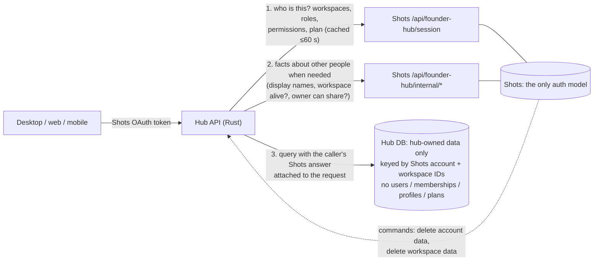

# Founder Hub: Shots as the only auth model, on its own database

**Status:** proposed. This replaces the earlier mirror-and-reconcile version of this plan.

## Decisions

- **One auth model: Shots.**
  - Shots decides who someone is, which workspaces they belong to, their role and permissions, and their plan.
  - The hub enforces Shots' answer for the request in hand. It never stores, copies or syncs identity, membership, permission or plan data.
- **The hub keeps only hub-owned data** (sharing, sync, attachments, transcription jobs, cloud API keys, integrations), keyed by Shots IDs.
- **Two parts, in this order:**
  - **Part A:** remove the hub's own auth model in place, on today's paired setup (hub schemas inside the Shots database).
  - **Part B:** move the hub to its own database. Once Part A is done there's nothing to sync, so Part B is mostly infrastructure.
- **The separate hub database is a Supabase project.**
  - Run it locally with the Supabase CLI for a few weeks and prove it in CI.
  - Then soak it in a free staging project, then go to production.
- **Optional later:** files on Cloudflare R2, and direct `sqlx` queries from Rust.
- **There are no users**, so there's no data migration or backward compatibility to preserve.

## Why: what's there today

### The hub still has upstream's auth model

- **Upstream's auth model is still here.** The hub's schema still contains it: `auth.users`, `profiles`, `workspaces`, `workspace_memberships`, invitations, seats, SSO, SCIM, domain auto-join, trials, referrals and Stripe-based plans.
- **Of the 386 current SQL functions, 101 depend on that copy of identity data:**

  | Table or function | Functions using it |
  |---|---|
  | `workspace_memberships` | 61 |
  | `auth.users` | 55 |
  | `profiles` | 16 |
  | Shots mirror tables | 12 |

- **Policies:** 14 of the 71 row-level security policies reference them too.
- **Foreign keys:** 52 foreign keys in 24 migration files point at `auth.users`.

### Central auth bolted a mirror onto it

- PRs #3 and #499 made it sign in through Shots and copy Shots' answer into hub tables (`project_shots_authority` → `auth.users`, `workspaces`, `workspace_memberships`, `private.shots_*`).
- **Shots writes hub tables directly** (`server/internal/product/founder_hub_*.go`, `server/internal/maintenance/accounts.go`).
- **The hub schema points into Shots:** a foreign key to `platform_founder_hub_user`, plus calls to `platform_founder_hub_account_available`.
- **Any copy creates a sync problem.** It can go stale when nobody in a workspace makes a request: a workspace deleted in Shots, a member removed, a plan expiring, an account deleted. Fixing that with a reconciler would keep two auth models alive. Removing the copy fixes it for good.

---

## Target design: Shots decides, the hub enforces



### The rules

1. **The caller's authority comes from Shots on every request.**
   - The hub already calls `GET /api/founder-hub/session` per request. It caches the answer in memory for up to 60 seconds, keyed by a hash of the token.
   - That cache is the only place Shots data lives in the hub, and it's never written to the database.
2. **The answer travels with the query.**
   - The hub mints its 60-second database JWT with the Shots answer as claims.
   - SQL reads permissions only through helper functions over those claims (section A2), never from tables.
3. **Facts about other people come from Shots at the moment of use.**
   - Examples: display names, a workspace's member list, whether a workspace still exists, whether a share owner can still share.
   - Rust asks Shots and passes the answer into the SQL call as parameters, or enriches the result after the call.
4. **Lifecycle events are commands, not sync.** Shots tells the hub "delete account X's data" or "workspace Y was deleted". The hub carries them out on its own data.
5. **Hub rows store Shots IDs as plain UUIDs.** There are no foreign keys to an identity table. The hub-owned workspace settings table is keyed by the Shots workspace ID.

### How the stale-copy cases resolve

Nothing is copied, so nothing can go stale for longer than the 60-second token cache.

| Case | What happens |
|---|---|
| Member removed in Shots | Their next request (after the cache) has no claim for that workspace, so access is refused. Other people's member lists come from Shots, so the removed person isn't shown |
| Workspace deleted in Shots | Share-link and public views check with Shots at view time (cached ≤60 s) and refuse. Shots also sends a command so the hub revokes links and schedules a purge |
| Plan or trial expires | Shots computes the plan at read time, so the next session answer (≤60 s) carries the new plan |
| Account deleted | Shots sends a command, the hub purges the account's data, and Shots finishes. The account's sessions stop working in Shots straight away |

### The claims contract

The hub mints the 60-second HS256 JWT with `SUPABASE_JWT_SECRET`. Shots and the hub keep a JSON Schema for it in both repos, under `contracts/founder-hub-claims.json`.

```json
{
  "sub": "<accountUserId>",
  "role": "authenticated",
  "email": "<verified email>",
  "shots_session_id": "<sessionId>",
  "workspaces": [
    {
      "id": "<workspaceId>",
      "kind": "personal | shared",
      "role": "owner | admin | ...",
      "permissions": ["workspace:read", "share:create", "..."],
      "features": { "workspace:paid": true }
    }
  ]
}
```

- **Member lists and names are not in the claims.** Those are other people's data and are fetched when needed.
- **Size guard:** cap at 100 workspaces per token. Beyond that, the hub requests a scoped answer for the workspace being acted on.

---

## Part A: one auth model, on today's setup

Part A runs on the existing paired setup (hub schemas in the Shots database, `scripts/local-dev.mjs`, the "Founder Hub paired integration" CI job). Each step merges with that CI green.

### A0. Inventory and classification

Produce `plans/auth-inventory.md`, listing every identity-dependent object with its fate. The objects are the 101 functions, 14 policies, 52 foreign keys, the identity tables, the hub's Rust call sites and the client call sites. The preliminary split:

**Delete (Shots owns it), about 55 functions:**
- workspace and team management: `create_workspace`, `rename_workspace`, `delete_workspace`, `leave_workspace`, `transfer_workspace_ownership`, `set_workspace_logo`, `set_workspace_membership_role`, `revoke_workspace_membership`, `list_workspace_memberships`, `list_workspace_members_with_profiles`, `get_workspace_access`, ownership requests
- workspace invitations
- seats: `enforce_workspace_seat_limit`, `get_workspace_seat_usage`, `workspace_seat_usage`, `enqueue_workspace_seat_billing`
- SSO and SCIM: `session_blocked_for_required_sso`, `scim_apply_user*`
- domain auto-join: `auto_join_email_workspace`, `capture_user_into_verified_domain_workspace`, `email_auto_join_domain`
- user lifecycle triggers: `handle_new_user*`, `handle_user_email_update`
- billing, trials and referrals: `can_start_trial`, `reserve_pro_trial`, `release_pro_trial_reservation`, `assign_profile_stripe_customer`, `claim_referral`, `get_referral_summary`, `claim_legacy_referral`, `is_paid_referrer`, `is_referral_extension`, `can_refer_for_month`
- the mirror: `project_shots_authority`, `project_shots_user`

**Replace with claims helpers, 8 functions:** `require_workspace_member`, `require_workspace_manager`, `require_permanent_user`, `shots_allows`, `shots_share_allows`, `shots_cloud_workspace_allows`, `workspace_capabilities`, `cloud_api_user_has_pro`. `sync_device_addon_count` takes its limit from the plan features in the claims.

**Rewrite: the hub feature stays, the identity parts change, about 40 functions:**
- **sharing and access:** `create_session_share`, `delete_session_share`, `set_session_share_scope`, `can_manage_session_share`, `is_session_share_manager`, `require_session_share_{editor,manager,attachment_manager}`, `resolve_{my_session_access,public_session_share,session_share_link,session_share_live_access}`, `list_my_accessible_sessions`, `list_session_share_access[_page]`, `list_session_share_comments`, `upsert_session_access_grant`, `prepare_my_session_share_attachment_download`, `protected_reactivate_session_share`, share invitations (`create_`, `inspect_my_`, `accept_session_access_invitation`)
- **shared resources:** `grant_shared_resource_access`, `list_shared_resources`
- **E2EE and sync:** `set_workspace_e2ee_key`, `list_workspace_key_recipients`, `list_[all_]my_workspace_e2ee_grants`, `publish_e2ee_member_identity`, `active_e2ee_freshness_key_id`
- **team share subdomain:** `set_workspace_share_slug`, `check_workspace_share_slug_availability`
- **cloud API:** `create_shots_cloud_api_key`, `lookup_shots_cloud_api_key`, `verify_cloud_api_key`, `publish_shots_cloud_api_snapshot`, `cloud_snapshot_readable`
- **account deletion:** `begin_account_deletion`, `capture_account_deletion_e2ee_scope`, `prevent_unpurged_account_auth_deletion` (dropped with `auth.users`)

**Tables:**
- **Drop:** `profiles`, `workspace_memberships`, workspace invitations and ownership requests, domain auto-join and SSO tables, SCIM state, seat and trial tables, the referral tables (`private.referral_*`), and the mirror (`private.shots_accounts`, `shots_workspaces`, `shots_memberships`).
- **Keep, slimmed:** `workspaces` becomes `private.workspace_settings(workspace_id uuid primary key, share_slug, e2ee key columns, …)` keyed by the Shots workspace ID. Name, owner, kind, logo and plan come from Shots.
- **Foreign keys:** all 52 to `auth.users` are dropped. The columns stay as `uuid NOT NULL`.
- **Kept until a later cleanup:** the `stripe` schema. No surviving function reads it.

**Acceptance:** every object is classified and reviewed, and every client and Rust call site of a deleted function is listed with its Shots replacement.

### A1. The claims contract and minting (hub)

- **Contract:** add `contracts/founder-hub-claims.json` in both repos. CI checks the copies are identical.
- **Minting:** `crates/api-auth/src/shots_storage.rs` mints the JWT from the session snapshot.
  - It adds `workspaces[]` (id, kind, role, permissions, features) and `role: authenticated` (today it's `shots_hub_authenticated`).
  - It stops calling `project_shots_authority`. Projection stays only until A6, as a no-op path behind a flag, so the database can still serve unconverted functions.
- **Session cache:** in `crates/api-auth/src/shots.rs` (`ShotsAuth::authenticate`), a `moka` LRU keyed by the SHA-256 of the token, about 10k entries, with a TTL of 60 seconds or less, capped at the Shots session expiry.
- **Workspace kind:** Shots' session snapshot gains `kind` (personal or shared) for each workspace.
- **Acceptance:** unit tests for minting, the claims size cap and cache expiry.

### A2. SQL claims helpers (hub migration)

New schema `hub`, created in a new migration:
- `hub.claims() → jsonb`: `request.jwt.claims`.
- `hub.account_id() → uuid`: `sub`.
- `hub.workspace_ids(permission text DEFAULT 'workspace:read') → uuid[]`.
- `hub.can(workspace_id uuid, permission text) → boolean`.
- `hub.require(workspace_id uuid, permission text)`: raises `42501`.
- `hub.feature(workspace_id uuid, flag text) → boolean`.
- `hub.is_service() → boolean`: service-role calls.

Tests:
- New pgTAP helper `tests.as_shots_user(account uuid, workspaces jsonb)`, which sets `request.jwt.claims` and `role`. It replaces `tests.create_supabase_user` / `tests.authenticate_as` in converted tests.
- **Acceptance:** pgTAP coverage for every helper, including no claims, a missing workspace and a missing permission.

### A3. Shots internal lookups (Shots repo)

These are new routes under `clients/apps/web/app/api/founder-hub/internal/`, backed by Go in `server/internal/product/founder_hub.go`. They require `x-shots-founder-hub-service: SHOTS_AUTH_SERVICE_TOKEN`.

| Route | Returns | Used for |
|---|---|---|
| `POST internal/accounts/lookup` `{ids[]}` | `[{accountUserId, name, image, status}]`. Email only where the requester's workspace contains that account | Display names on comments, access lists and share UIs. Account status for cleanup |
| `GET internal/workspaces/{id}` | `{workspaceId, organizationId, name, kind, deleted, owner, members[{accountUserId, name, image, role, permissions}], features}` | Member lists, E2EE key recipients, owner checks |
| `GET internal/workspaces/{id}/authority?account={accountUserId}` | `{exists, deleted, role, permissions, features}` | Share-link and public views; background jobs acting for an account |

- Results are cached in the hub for 60 seconds or less. The hub client lives in a new `crates/api-auth/src/shots_directory.rs`.
- **Acceptance:** Go tests for authorization, deleted workspaces, members in deletion, banned members and response shape.

### A4. Convert hub features, one domain per PR (hub)

**Each PR:**
1. Rewrites the domain's SQL functions and policies to use the `hub.*` helpers instead of `workspace_memberships`, `auth.users`, `profiles` or the mirror.
2. Moves cross-user facts to parameters supplied by Rust, or to enrichment in Rust using `shots_directory`.
3. Converts that domain's pgTAP tests to `tests.as_shots_user` and deletes tests for deleted functions.
4. Updates the Rust call sites and their wiremock tests.
5. Updates the gateway allowlist (`apps/api/src/shots.rs`) and any client calls.

**Order:**

| PR | Domain | Notes |
|---|---|---|
| A4.1 | Sharing and access | Owner and workspace checks for link and public views call `shots_directory.authority()` before the SQL read (`crates/api-sync/src/shared_notes.rs`). Comment and access-list names come from `accounts/lookup`. Invitations match the caller's verified `email` claim |
| A4.2 | Shared resources | Shots' resources route moves to the hub internal API (B3). Guests are checked through the claims |
| A4.3 | E2EE and sync | Rust passes key recipients (member IDs from `internal/workspaces/{id}`) into `set_workspace_e2ee_key` and `list_workspace_key_recipients`. Device limits come from the claims features |
| A4.4 | Team share subdomain | `set_workspace_share_slug` requires `hub.can(ws, 'workspace:manage')`, and the slug lives in `workspace_settings` |
| A4.5 | Cloud API and MCP | Keys bind to `(account, workspace)`. Verification uses `key-session` / `connector-session` (already Shots) plus the claims |
| A4.6 | Integrations (Nango) | `nango_connections.user_id` is a plain account ID, and ownership checks use `hub.account_id()` |
| A4.7 | Transcription jobs and attachments | `user_id` checks use `hub.account_id()`. Workspace-scoped attachments use `hub.can` |

### A5. Delete what Shots owns (both repos)

**Hub repo:**
- Delete the functions and tables marked "delete" in A0, and remove them from the gateway allowlist.
- **Desktop:** `apps/desktop/src/settings/team/client.ts` (29 team functions, 26 of them not even allowlisted today) is removed. Team management lives in Shots settings (the `ShotsSettings` route already exists for Shots builds).
- **Web:** billing (`profiles`, trial functions), referrals and team pages route to Shots. `.from("workspaces")` in desktop, web and mobile (`lib/account-plan.ts`, `auth/account-plan.ts`, `shots-voice/runner.ts`) reads the workspace list from a new gateway endpoint, `GET /cloud/me`, which returns the cached Shots snapshot.
- **Avatars:** profile images belong to Shots. Remove `packages/supabase/src/profile-avatar.ts`, which uses `auth.updateUser` and has no route in the Shots setup today.
- **Rust:** remove the `api-subscription` routes that only made sense with hub billing. Already unmounted in the Shots setup; delete them.

**Shots repo:**
- Move referrals fully into Shots: Shots-owned `platform_referral_*` tables and Go logic, keeping `/api/founder-hub/referrals*`.
- Delete `founder_hub_context.go`'s projection and claim-setting.

**Acceptance:** searching the hub for `workspace_memberships|auth\.users|profiles|shots_(accounts|workspaces|memberships)` finds nothing outside dropped migrations, and the paired CI is green.

### A6. Commands instead of direct writes (both repos)

| Today | After |
|---|---|
| `accounts.go` reads and writes hub tables | Shots calls `POST {HUB}/internal/accounts/{id}/deletion` (idempotent), `GET …/deletion` (`pending` / `blocked` / `complete`) and `GET …/deletion-blockers`. The hub cleanup worker purges hub rows by account ID, plus storage prefixes. Shots completes when the hub reports `complete` |
| Workspace deletion leaves hub data untouched | Shots calls `POST {HUB}/internal/workspaces/{id}/deletion`. The hub revokes that workspace's shares and links and schedules a purge |
| `founder_hub_resources.go` calls hub SQL | Shots calls `POST {HUB}/internal/resources` (service token + `x-account-user-id` + workspace). The hub runs the same functions as that account |
| `founder_hub_crm.go` calls `upsert_` / `delete_nango_connection` | Shots calls `POST` / `DELETE {HUB}/internal/nango/connections` (service token + account ID). The hub owns `nango_connections` and shares the Nango environment with Shots |
| `platform_account_attachment_blockers()` reads hub tables | Replaced by `GET …/deletion-blockers` |

- **New hub module** `apps/api/src/internal.rs`, mounted at `/internal`. It requires `HUB_INTERNAL_SERVICE_TOKEN`, is reachable only on the private network, and is rate-limited and logged.
- **Acceptance:**
  - Searching Shots code for `founder_hub(_private|_identity|_billing)?\.` finds nothing outside the migration runner.
  - The deletion handshake and workspace-deletion command pass end to end in the paired CI.

### A7. Remove the identity layer (hub)

- Drop the mirror tables, the `project_*` functions and the custom access-token hook.
- Drop the 52 foreign keys to `auth.users`, and the triggers on `auth.users`.
- Drop the projection flag from A1.
- Remove the shared advisory lock `716268349103` usage, plus the trigger and functions calling `platform_founder_hub_account_available`.
- **Acceptance:**
  - The hub schema references no `auth.*` object except the role names.
  - The paired CI and `db_ci` are green.
  - Shots' import check (`dev/import-founder-hub-schema.py --check`) passes with the new migrations.

**Part A is done when:** the acceptance list in section 4 passes in the paired CI on the shared database, with no hub-side identity data.

---

## Part B: the separate database

After Part A the hub schema has no identity tables and no references into Shots. The only links left between the systems are the session call, the internal lookups and the commands, all over HTTPS.

### B1. One schema source on local Supabase (hub)

- **Bring in the six hub migrations that exist only in Shots,** rewritten in original names, minus anything Part A deleted:
  - `20261110010000`
  - `012000`
  - `013000`
  - `014000`
  - `014001`
  - `150000`
- **Supabase CLI:** pin the version in `db_ci.yaml`, `Taskfile.yaml` and the paired workflows. Today `db_ci` uses `latest`.
- **Test helpers:** vendor `basejump-supabase_test_helpers` (`supabase/tests/000-setup-tests-hooks.sql` downloads it from api.database.dev today), or drop it once every test uses `tests.as_shots_user`.
- **Supabase Auth:** turn off sign-ups and providers in `supabase/config.default.toml`. Supabase Auth goes unused, and only the JWT secret matters.
- **HMAC secrets:** give the two places that reuse the service-role key their own secrets:
  - `LIVE_DOC_TICKET_SECRET` for `crates/api-sync/src/live_docs.rs`
  - `PROXY_SIGNING_SECRET` for `apps/api/src/proxy/client_ip.rs`
- **Acceptance:** `supabase db reset` and `supabase test db` pass on a clean local project.

### B2. Local `separate` profile and CI (both repos)

- **`scripts/local-dev.mjs --profile separate`:**
  - Shots runs without `--founder-hub` and without PostgREST, storage-api or `founder-hub-storage`.
  - The hub runs `task supabase-start`.
  - The hub API uses `SUPABASE_URL=http://127.0.0.1:54321` and the keys from `supabase status`, plus `SHOTS_AUTH_URL`, `SHOTS_AUTH_SERVICE_TOKEN`, `HUB_INTERNAL_URL` and `HUB_INTERNAL_SERVICE_TOKEN`.
  - A seed script creates Shots users and workspaces.
- **Paired workflow:** add a `separate-db` entry to `founder-hub-integration.yml` in both repos. Point the hub checkout at `develop`; it currently uses `fix/shots-central-auth`.
- **New crate `crates/hub-it`:** Rust integration tests for the hub API against local Supabase and a Shots stub or real Shots.
- **Attachment URLs:** signed URLs carry the public storage origin. Clients validate against a configured `VITE_STORAGE_ORIGIN`, not `<API>/cloud`; today these don't match (`crates/attachment-sync-core/src/download.rs`, `apps/desktop/src/shared-notes/preview.tsx`). `plugins/attachment-sync` reads that origin at runtime, not through `option_env!`.
- **Voice:** remove `/cloud/voice` forwarding (Shots has no such route), or add the route.

### B3. Local soak (2–4 weeks)

- Use the `separate` profile daily, and add a regression test for every defect found.
- **Exit:** the acceptance list passes in CI for 10 consecutive days, with no open P1 or P2 defects.

### B4. Staging (days)

- **Project:** create a free Supabase project, `hub-staging`, then `supabase link` and `supabase db push`.
- **Deploy:** the hub API (`ANARLOG_SERVICE=all`) goes to staging, pointing at Shots staging. Shots staging gets `HUB_INTERNAL_URL` and `HUB_INTERNAL_SERVICE_TOKEN`.
- **Configure:**
  - the project JWT secret, matching the hub's `SUPABASE_JWT_SECRET`
  - buckets and their limits (`audio-files`, `attachment-backups` 520 MiB, `shared-note-attachments` 512 MiB, `profile-avatars` only if still used after A5)
  - network restrictions and the pooler
- **Checks:** run the acceptance list, then a backup and restore drill.

### B5. Production

1. Provision `hub-prod` with the staging settings, run `supabase db push`, and set the secrets.
2. Shots production: `HUB_INTERNAL_URL` and `HUB_INTERNAL_SERVICE_TOKEN`.
3. **App builds:** `VITE_SHOTS_URL`, `VITE_API_URL` and `VITE_STORAGE_ORIGIN` in `desktop_cd.yaml`, `desktop_ci.yaml`, `web_cd.yaml` and the mobile EAS profiles.
4. **Shots repo cleanup:**
   - delete `server/founderhubmigrations/`, `dev/import-founder-hub-schema.py`, `server/cmd/founder-hub-storage/` and the `--founder-hub` flag
   - delete the CI steps in `.github/workflows/ci.yml:324-341`
   - drop the `founder_hub*` schemas and `shots_hub_*` roles in a Shots platform migration
   - keep `platform_founder_hub_user` and `platform_founder_hub_workspace`, the ID mappings that are part of Shots' own model
5. **Exit:** a production smoke test runs the acceptance subset with a real Shots account.

### Optional later phases

- **R2 for files:**
  - Swap `crates/supabase-storage` for the existing `crates/s3` (aws-sdk-s3 presigning, MinIO tests) pointed at R2.
  - Add a file-metadata table to replace `storage.objects`, and rewrite the storage policies and the account-deletion "prefix empty" checks against it.
  - Replace TUS resumable uploads with S3 multipart, keeping 6 MiB parts.
  - Update the client URL validators to accept R2 presigned URLs.
- **Direct `sqlx`:**
  - Turn on sqlx's `postgres` feature and add a `db` module with a pool, `rpc(name, args)` and `as_user(claims)`, which runs `SET LOCAL ROLE authenticated` plus the claims.
  - Convert the 115 REST call sites, map SQLSTATEs to today's HTTP errors, and replace the `PGRST202` fallback with `42883`.

---

## 1. Configuration

**Hub API:**
- `SUPABASE_URL`, `SUPABASE_ANON_KEY`, `SUPABASE_SERVICE_ROLE_KEY`, `SUPABASE_JWT_SECRET`
- `SHOTS_AUTH_URL`, `SHOTS_AUTH_SERVICE_TOKEN`
- `HUB_INTERNAL_SERVICE_TOKEN` (new)
- `LIVE_DOC_TICKET_SECRET`, `PROXY_SIGNING_SECRET` (new)
- `FOUNDER_HUB_MCP_URL`, `RESEND_API_KEY`, `RESEND_FROM_EMAIL` (needed when sync is on)
- `POSTHOG_API_KEY` (release builds)
- Hosted AI keys: optional at launch
- `NANGO_*`: same environment as Shots
- `ANARLOG_SERVICE=all`

**Shots:**
- Add `HUB_INTERNAL_URL` and `HUB_INTERNAL_SERVICE_TOKEN`.
- Add `SHOTS_AUTH_SERVICE_TOKEN`, `FOUNDER_HUB_WEB_ORIGIN` and `FOUNDER_HUB_MCP_URL` to the Helm chart (`infra/charts/screenshot-studio`). Today the chart passes none of them, and the migrate job never sets `FOUNDER_HUB_WEB_ORIGIN`.
- Move `NANGO_*` to the Go product API container.
- Remove `FOUNDER_HUB_DB_*` in B5.

**App builds:** `VITE_SHOTS_URL`, `VITE_API_URL`, `VITE_STORAGE_ORIGIN`.

## 2. Hosting

- **Hub API:** a `founder-hub-api` component in Shots' Kubernetes chart (proposed). Public at `api.shots.playbookmedia.io`; `/internal` reachable only inside the cluster.
- **Hub database:** a Supabase project in Shots' region.

## 3. Testing

| Layer | What |
|---|---|
| SQL (pgTAP) | Claims helpers. Every converted function, tested with `tests.as_shots_user`. Tests for deleted functions are removed |
| Rust unit | Claims minting, session cache, `shots_directory` cache, internal API auth, and the converted call sites |
| Rust integration | `crates/hub-it` runs the hub API against local Supabase plus a Shots stub |
| Shots (Go) | The internal lookups and session `kind`, referrals in Shots, and the hub command clients |
| End to end | The paired workflow: today's profile during Part A, then `separate-db` in Part B (Playwright and desktop WebDriver) |

## 4. Acceptance list

These run in CI on every PR, and on staging before production.

1. Desktop sign-in through Shots. `/cloud/auth/v1/user` and `/cloud/me` return the Shots account and workspaces, and nothing is written to hub identity tables (there are none).
2. Token refresh, logout, and a revoked Shots session: the hub refuses within 60 seconds.
3. A role change, a permission-group change, and removing a member in Shots: access changes within 60 seconds. Other members' lists show the change at once, because they're read from Shots.
4. Plan upgrade, downgrade and trial expiry: Pro features follow within 60 seconds.
5. Sharing: create, invite (by email, accepted with a matching verified email), comment (author names come from Shots), live edit, revoke. Stable, public and link shares, with previews.
6. Workspace deleted in Shots: its share and public links fail at once (view-time check), and the deletion command revokes and schedules the purge.
7. Shared resources from both the Shots settings UI (through the hub internal API) and the desktop.
8. Attachments: private backup and restore, shared attachment upload and download, a 500 MB file, and a hash mismatch rejected.
9. Sync: device claim and rename, E2EE enrollment, key recipients taken from Shots members, witness, replica accept.
10. Cloud API and MCP: create a key, verify it, connect through a connector, revoke it, and remove the member, which invalidates the key's access.
11. Integrations: a Nango calendar connection created in the hub, and a CRM connection registered from Shots and used by the hub.
12. Referrals served from Shots.
13. Account deletion handshake: blockers reported, cleanup completes, storage prefixes empty, and Shots marks the account COMPLETED.
14. With Shots unavailable: cached sessions keep working for 60 seconds or less, then requests fail with a clear 503. No decision is ever made on data older than the cache.

## 5. Risks

| Risk | Mitigation |
|---|---|
| Rewriting about 40 functions and their tests introduces regressions | One domain per PR. pgTAP tests before and after each conversion. The paired CI on every PR |
| Shots outage blocks the hub | The same dependency as today's per-request session check. Clear 503s and alerts. Caches are 60 seconds or less |
| JWT grows large with many workspaces | Cap the workspaces per token. A scoped answer for big accounts |
| Extra Shots calls for names and view checks | 60-second caches. A batch accounts lookup. View checks only for link and public views |
| Clients still call deleted functions | The A0 inventory lists every call site. The allowlist rejects unknown calls with a clear error |
| Schema drift between repos during Part A | Part A changes land here and are imported into Shots with `--check` in CI until B5 removes the import |
| Supabase CLI and hosted Supabase behave differently | A pinned CLI, the staging soak and a restore drill |

## 6. Open questions

1. **Personal workspaces:** Shots' snapshot needs a `kind` per workspace. Is every Shots user guaranteed a personal workspace, or should the hub treat "no personal workspace" as an error?
2. **The yc perk table** (`yc_perk_claims`, used by web): move to Shots or drop it?
3. **Account analytics** (`reconcile_account_analytics_events` and the `auth.users` triggers): move to Shots' analytics or drop them?
4. **Hosted AI at launch:** run with provider keys, or local and bring-your-own-key only?
5. **When to remove the `stripe` schema** after Part A.

## 7. Size and order

| Step | Repos | Size | Depends on |
|---|---|---|---|
| A0 Inventory | hub | S | — |
| A1 Claims and minting | hub | S | A0 |
| A2 SQL helpers | hub | S | A0 |
| A3 Shots lookups | Shots | S–M | A0 |
| A4 Convert domains (7 PRs) | hub | L | A1–A3 |
| A5 Delete what Shots owns | both | M | A4 for affected callers |
| A6 Commands | both | M | A3 |
| A7 Remove the identity layer | hub | S | A4–A6 |
| B1 Schema on local Supabase | hub | S | A7 |
| B2 Separate profile and CI | both | M | B1 |
| B3 Local soak | — | 2–4 weeks | B2 |
| B4 Staging | both | S | B3 |
| B5 Production and Shots cleanup | both | S | B4 |

## Sources

Inventories taken from `develop` in both repositories on 2026-11-11:
- **Hub:** `supabase/migrations` (170), `supabase/tests` (69), `crates/api-*`, `crates/supabase-storage`, `apps/api/src/{env,shots,main}.rs`, and the desktop, web and mobile clients.
- **Shots:** `server/internal/product/founder_hub*.go`, `server/internal/maintenance/accounts.go`, `server/founderhubmigrations/`, `server/platformmigrations/sql/2026110919*`–`20261110*`, `clients/apps/web/app/api/founder-hub/**`, `infra/charts/screenshot-studio`.

The function counts come from the latest definition of each function across all migrations.
